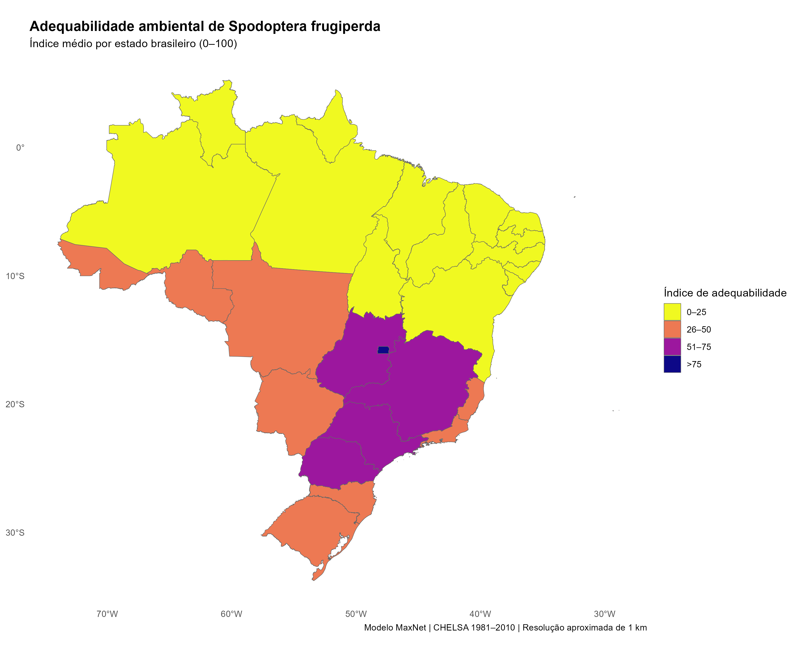

# ENM_PPGAG_2026
Códigos para a disciplina de 2026

Olá! Bem-vindos à disciplina do PPGAG que aborda teoria e prática sobre os Modelos Ecológicos de Nicho.

Responsável: Prof. Dr. Mário S. M. Tagliari
Contato: mariotagliari@utfpr.edu.br

A disciplina acontece entre os dias 16 até 19 de novembro com encontros síncronos e presenciais. Não teremos aula remota.

Após a conclusão das aulas teóricas e práticas teremos a entrega de uma avaliação final até o dia 07 de dezembro. A atividade avaliativa será abordada durante a disciplina.

Excelente disciplina a todos :)

## Resultados

### Adequabilidade ambiental de _Spodoptera frugiperda_

